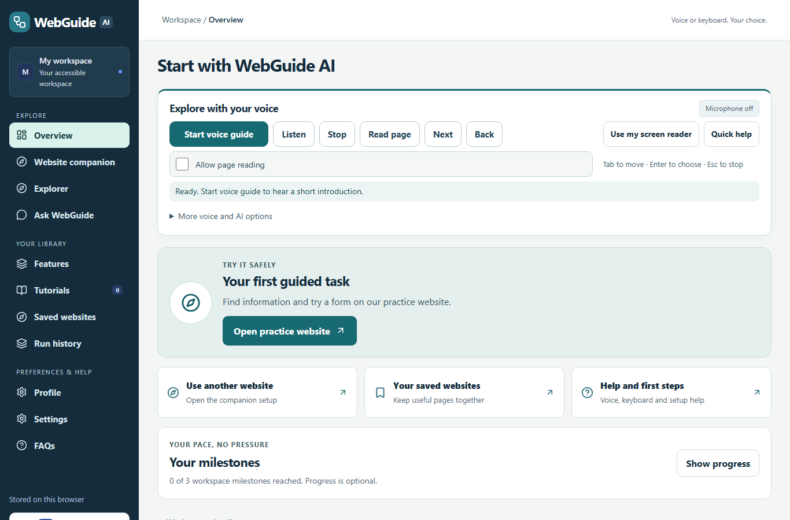
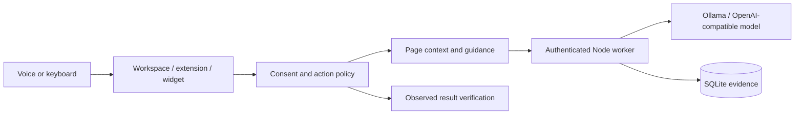

<div align="center">

# WebGuide AI
### Your voice. Your keyboard. Your next step.

Voice-assisted website guidance for blind and low-vision users.
 **Project repository:** [riya-ydv/WebGuide-AI](https://github.com/riya-ydv/WebGuide-AI)

**[Open live demo](https://webguide-ai-live.plushmole8.chatgpt.site/)** · **[Download & setup](https://webguide-ai-companion.plushmole8.chatgpt.site/)** · **[Presentation](https://webguide-ai-companion.plushmole8.chatgpt.site/WebGuide_AI_Final_Presentation.pptx)**

**Project owner and lead contributor: Riya Yadav**

</div>

[](https://webguide-ai-live.plushmole8.chatgpt.site/)

> Click the preview to try the app. The browser demo runs the frontend and controlled practice workflows. **Real AI needs the local launcher or a separately hosted backend.** A remote AI backend is not currently published.

## Start here

| I want to… | Start here |
| --- | --- |
| Show the interface without installing anything | [Live browser demo](https://webguide-ai-live.plushmole8.chatgpt.site/) |
| Run the complete app with local AI | [Download the package](https://webguide-ai-companion.plushmole8.chatgpt.site/) → extract → open the launcher |
| Use WebGuide on another website | [Install the Chrome/Edge companion](docs/EXTENSION_QUICK_START.md) |
| Present the project | [22-slide PowerPoint](https://webguide-ai-companion.plushmole8.chatgpt.site/WebGuide_AI_Final_Presentation.pptx) · [Stage 4 comparison](submission/Stage_4_Comparison.md) |
| Check what was actually tested | [Acceptance evidence](docs/FRESH_ACCEPTANCE_2026_11_15.md) · [Security notes](SECURITY.md) |

## What you can do

- **Speak or type a command:** read a page, find headings and links, move focus, or open a workspace section.
- **Stay in control:** page reading and AI context sharing require permission. Confirm supported actions; Stop or Escape cancels assistance.
- **Get grounded guidance:** the local model explains observed controls and asks for clarification when page context is insufficient.
- **Practise safely:** explore the included synthetic website and forms before trying another site.
- **Keep useful work:** save websites, guides and progress; manage a browser-local profile and workspace backups.
- **Choose your pace:** English/Hindi commands, repeat/simplify options and optional progress milestones.

### A short first walkthrough

1. Open the app and choose **Start voice guide** for a spoken introduction.
2. Allow page reading when you want navigation help.
3. Choose **Listen** to use the microphone, or type `open profile`.
4. Try `next`, `read focused` or `list headings`. Confirm only the action you intend.
5. Press **Escape** or **Stop** to stop WebGuide. A separate screen reader has its own stop command.

## Run on your computer

| Computer | Open after extracting the package |
| --- | --- |
| MacBook — macOS 14+, Apple Silicon or Intel | `Start WebGuide.command` |
| Windows | `Start WebGuide.bat` |

The launcher downloads private, verified runtimes, Chromium and Qwen3 4B. Allow several GB of first-time downloads and **at least 12 GB free disk space**. Keep the launcher window open. Basic controls appear before model setup finishes; wait for the connected tab to use AI. Later launches reuse the downloads.

<details>
<summary><strong>Reopen, reconnect or stop</strong></summary>

After refreshing or closing the app, double-click the same launcher again after it says Ready. Alternatively, type `o` then Return in its window. Type `q` then Return to stop the services it started. See [complete quick start](START_HERE.md) and [Mac troubleshooting](docs/MAC_SETUP.md).

</details>

<details>
<summary><strong>Develop from source</strong></summary>

Use Node.js 24+ and npm:

```sh
npm ci
npm run dev
```

Open `http://127.0.0.1:4320`. This starts the frontend only. The launcher is the normal complete local-AI path. For a custom model/worker, see [server setup](docs/SERVER_SETUP.md). Keep filled `.env` files and access tokens private.

```sh
npm run typecheck
npm test
npm run build
python scripts/check-publication.py
```

Worker integration tests additionally need Chromium: `npx playwright install chromium`, then `npm run test:worker`. If your own controlled fixture is already running on port 4319, set `WEBGUIDE_TEST_REUSE_FIXTURE=1`; the test verifies its identity and does not stop it.

</details>

<details>
<summary><strong>Install the browser companion</strong></summary>

Use desktop Chrome or Edge. Open `chrome://extensions` or `edge://extensions`, enable **Developer mode**, then choose **Load unpacked**. Select the extracted `browser-extension` folder containing `manifest.json`. Pin the icon, open your website and choose **Open companion on this page**. Re-activate after full navigation.

Opening a website from the dashboard alone does not install the extension. Safari, mobile browsers and browser-internal pages are not supported. [Full extension guide](docs/EXTENSION_QUICK_START.md).

</details>

## How it fits together



React + TypeScript power the interface. Standard Vite, TanStack Start and Nitro build the app. The server-side worker uses Playwright, schema validation and SQLite; model credentials never belong in the browser bundle. [Architecture and G01–G12 mapping](docs/GAP_TO_FEATURE_MAPPING.md).

## Evidence and limitations

The project includes automated test and acceptance records. Detailed documentation distinguishes unit tests, browser automation, model inference and human observations.
- Automated accessibility checks do not establish usability for every blind user.
- A complete physical Mac/VoiceOver workflow and recipient-device spoken-command test remain unverified.
- Website structure, embedded frames, canvas controls and browser restrictions affect compatibility.
- Browser speech recognition may use an online service even when the AI model is local.
- The backend is currently single-owner; do not expose it as an unrestricted multi-user API.

[Latest acceptance](docs/FRESH_ACCEPTANCE_2026_11_15.md) · [Assistive-technology checks](docs/ASSISTIVE_TECH_ACCEPTANCE.md) · [Hosted backend guide](docs/HOSTED_BACKEND.md)

## Ownership and contributions

**Riya Yadav is the project owner and project lead of WebGuide AI.** She established the project direction, identified the intended users and accessibility needs, defined the requirements, and leads its evaluation, documentation and presentation. The project was developed with implementation support and AI-assisted tools. Testing results and limitations are documented according to what has actually been verified.

For a useful issue, include the browser/OS, exact steps, expected behaviour and actual result. Remove tokens, personal page content and private logs first. Report security concerns privately as described in [SECURITY.md](SECURITY.md).


